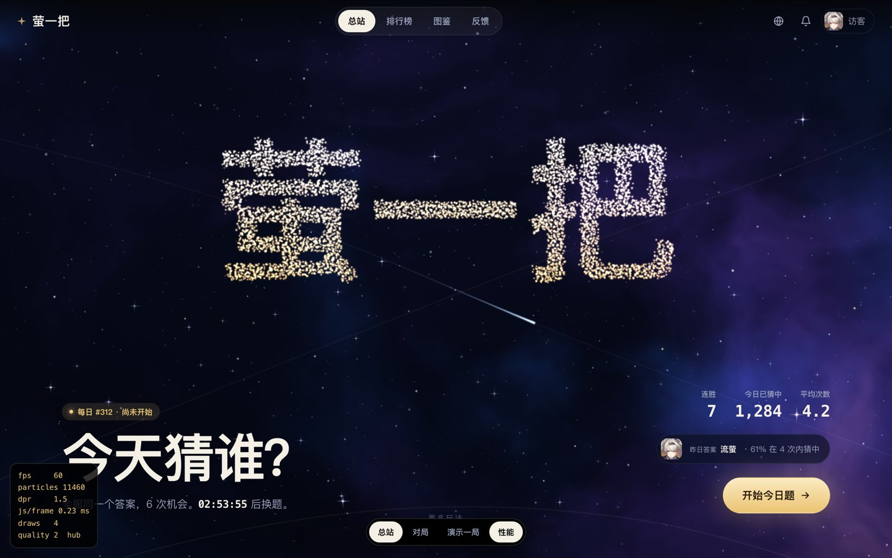
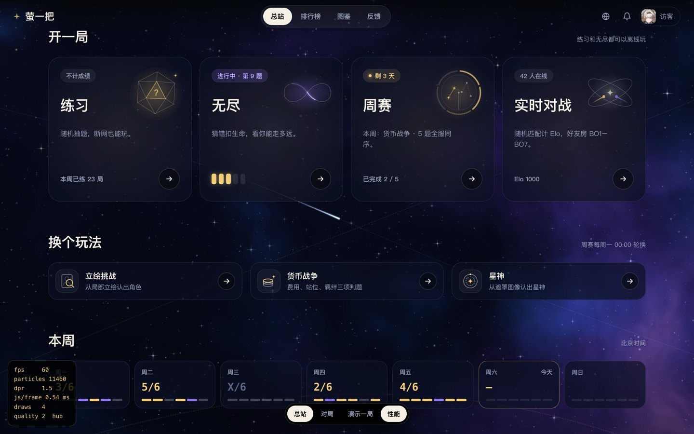
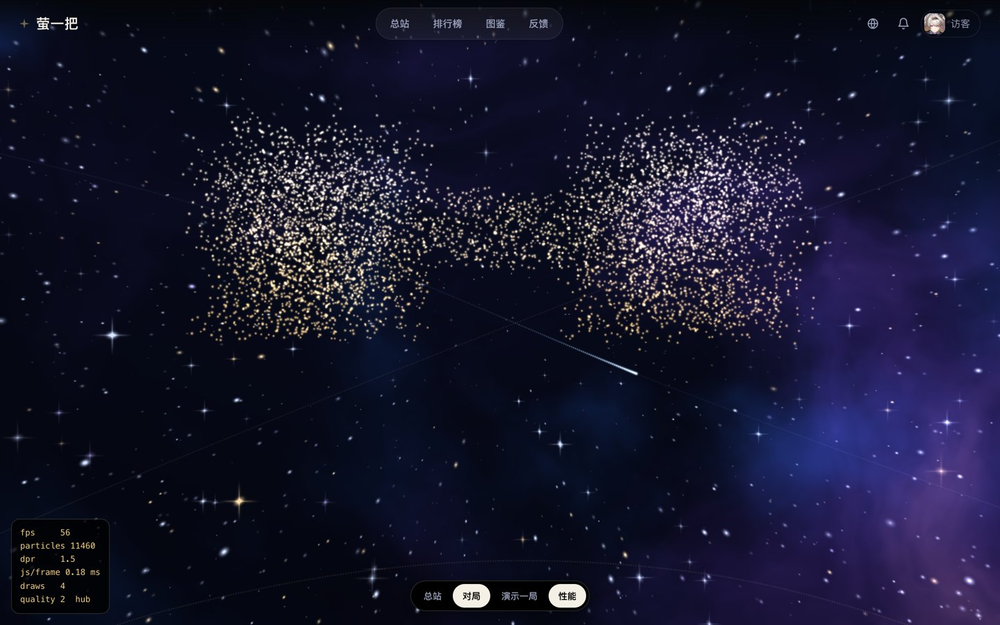
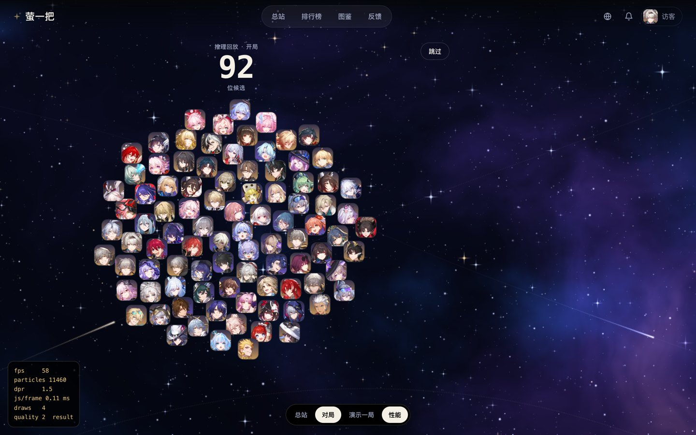
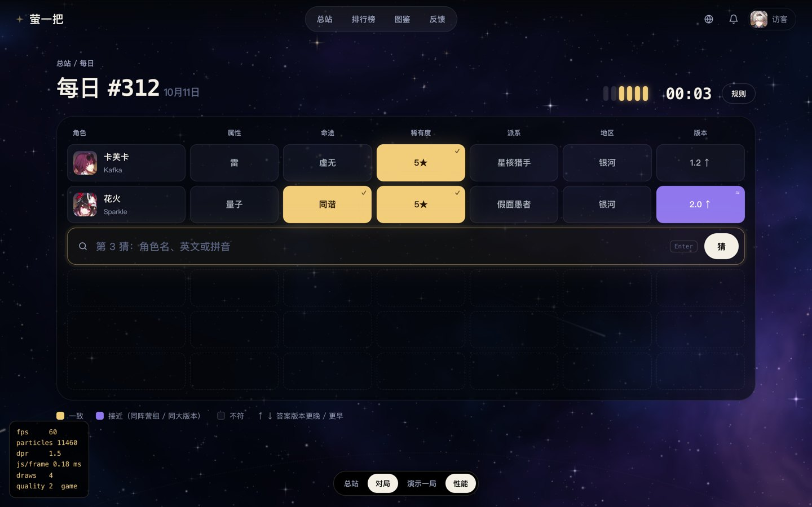
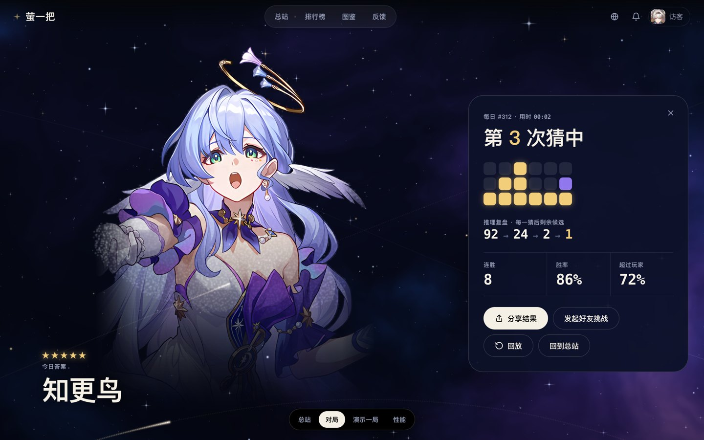
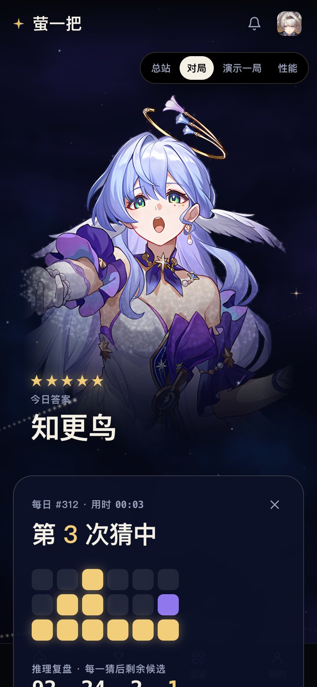
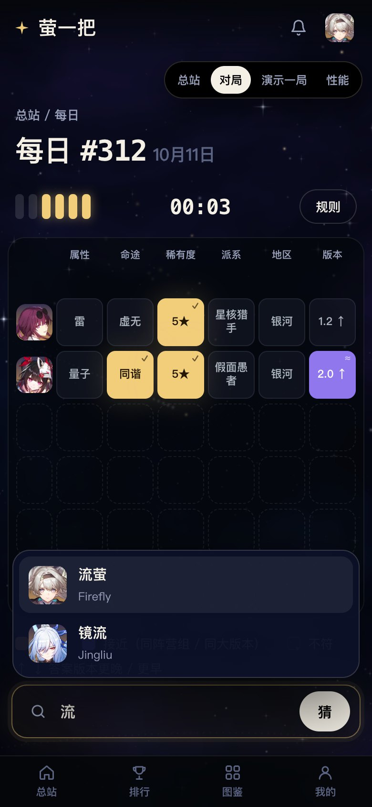
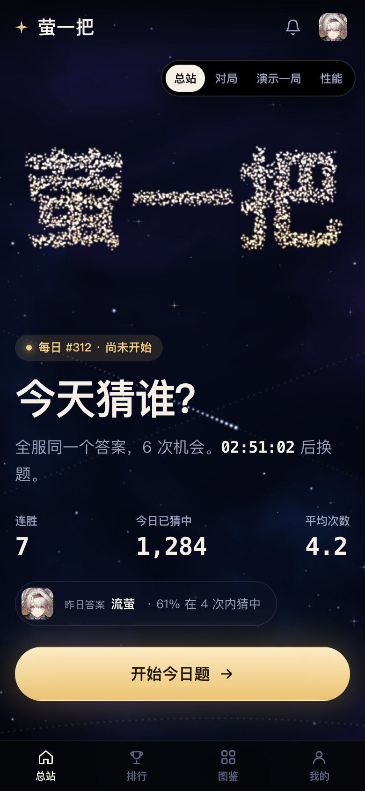

# 萤一把重设计提案 v2 ·「星轨」

> 状态：**已采纳并在 `apps/web` 落地**，取代 [v1「萤光」](../redesign/README.md)。
> 可交互原型：[prototype.html](prototype.html)，用浏览器直接打开（需要联网从 jsDelivr 加载 three.js 和 GSAP）。底部黑条可以切换 总站 / 对局 / 演示一局 / 性能面板。
> URL 参数：`?view=game` 直接进对局，`?demo` 自动演示一局，`?perf` 打开性能面板，`?reduce` 模拟“减少动态效果”，`?nogl` 模拟 WebGL 不可用。
>
> 落地说明：实现走原生 three.js + CSS 自定义属性，**没有引入 GSAP**（原型里的错峰动效改用 CSS 变量与着色器实现）。`CONTEXT.md` 的「整体动效语言」已按第 5 节改写（对局中保留变暗降速的星空，棋盘本体不放常驻粒子），`docs/DESIGN_SYSTEM.md` 已同步为 v2 令牌与组件族。

## 1. 为什么改 v1

v1 用黑底加萤光绿，和《崩坏：星穹铁道》本身没有关联，看起来像一个通用工具站。v2 改成直接借用星铁玩家熟悉的视觉记忆，同时继续避开旧版那些装饰：菱形框、编号小标题、切角票券按钮和衬线大标题。v2 用到的星铁元素有：

| 星铁元素               | 在本站里的用途                                                                                                 |
| ---------------------- | -------------------------------------------------------------------------------------------------------------- |
| 深空、星云、四芒星     | WebGL 背景。星云只在启动时烘焙一次，之后每帧只做一次纹理采样                                                   |
| 星轨（列车行驶的轨道） | 三条样条曲线，光点沿轨道行进                                                                                   |
| 跃迁                   | 从总站进入对局的转场：星点拉成径向光轨，向镜头飞去                                                             |
| 5★ 金 / 4★ 紫          | 判题配色：**一致 = 星光金，接近 = 星云紫**。星铁玩家看到金色就知道“最好”，看到紫色就知道“次好”，不需要额外学习 |
| 跃迁出金               | 揭晓答案时按稀有度出现金光或紫光闪光，然后星尘汇聚成立绘                                                       |

## 2. 设计令牌

```css
--bg: #050817; /* 深空靛蓝 */
--ink: #f4f0e6; /* 暖白 */
--muted: #98a0ba;
--panel: rgb(11 15 36 / 70%); /* 半透明深蓝面板，不使用 backdrop-filter */
--lit: #f2cd7a; /* 星光金：一致 / 5★ */
--near: #9077ee; /* 星云紫：接近 / 4★ */
--miss: rgb(170 185 255 / 6%); /* 不符：几乎透明，保持安静 */
```

- 主按钮使用奶油金渐变胶囊 `#fdf0d2 → #e8c171`，配深色文字，接近游戏内按钮的质感。
- 状态不只靠颜色区分：一致格带 `✓`，接近格带 `≈`，版本列带 `↑ / ↓`。
- 字体：粗无衬线字体，数字使用等宽字体并开启 `tabular-nums`。

## 3. 关键动效

| 时刻            | 效果                                                                                            | 实现                                                                                                                                |
| --------------- | ----------------------------------------------------------------------------------------------- | ----------------------------------------------------------------------------------------------------------------------------------- |
| 进入总站        | 星点从四周汇聚成“萤一把”三个字，鼠标经过时星点会被推开                                          | 文字先画到 2D canvas 上，再按笔画面积推算网格步长并采样；形态切换由顶点着色器在 `uMorph` 控制下插值                                 |
| 向下滚动        | 字形散开，回到星空                                                                              | ScrollTrigger 只读取滚动位置，不劫持滚动                                                                                            |
| 开始今日题      | 跃迁：星点拉成光轨，约 1.5 秒后静止                                                             | `uWarp` 让点精灵沿径向拉长，`uFly` 让星点沿 z 轴循环飞行                                                                            |
| 每次猜测        | 判题格依次 3D 翻开；一致格亮起，并把金色星尘洒进背景                                            | GSAP stagger；星尘使用一个 384 粒的环形缓冲区，只在命中时写入                                                                       |
| 猜中            | 整行依次跳起                                                                                    | GSAP                                                                                                                                |
| 结算 · 推理回放 | 92 个候选头像排成葵花阵，每一猜之后被排除的头像坠落，剩下的重新排布，计数器同步 92 → 24 → 2 → 1 | 92 个 DOM 头像，只做 transform/opacity 动画；排除集合复用推理复盘的计算逻辑                                                         |
| 结算 · 揭晓     | 最后一个头像放大，出现稀有度色的跃迁闪光，星尘汇聚成答案立绘，然后真实立绘淡入                  | 立绘点云在构建期预先算好（`120×163`，约 7000 点，约 47KB base64），所以不需要在运行时读取图片像素，`file://` 和跨域环境都不会受影响 |

回放提供“跳过”按钮。同一天第二次打开结算时，应直接跳到最终状态（原型里的“查看结算”按钮就是这样做的）。

## 4. 性能

| 项           | 做法                                                                                                                       |
| ------------ | -------------------------------------------------------------------------------------------------------------------------- |
| 绘制调用     | 每帧固定 4 次：星云纹理、星点、星轨、星尘                                                                                  |
| CPU          | 所有逐帧运动都在着色器里完成，JS 每帧只更新 uniform。本机 headless Chrome 测得每帧 JS 0.1–0.4ms                            |
| 帧率         | 本机测得桌面 9000 星点加 2460 个星轨点、移动端 4200 星点加 1260 个星轨点，均稳定在 60fps。跃迁期间点精灵变大，会有短暂掉帧 |
| 分辨率       | DPR 上限：桌面 1.5，移动端 1.25；星云按 0.5 倍分辨率烘焙一次                                                               |
| 自适应降级   | 连续 2 秒低于约 40fps 时，先把 DPR 降到 1，再把粒子数减半                                                                  |
| 对局中       | 星空亮度降到 0.45，时间流速减半，渲染降到 30fps；只有星尘迸发或跃迁时才恢复 60fps                                          |
| 后台         | 页面隐藏时 rAF 自动停止；时间增量有上限，切回页面时不会跳帧                                                                |
| 低端设备     | `hardwareConcurrency <= 4` 或开启省流量（Save-Data）时使用 2600 个星点                                                     |
| 减少动态效果 | 只渲染一帧静态画面（字形已成型），关闭跃迁和回放，结算直接显示最终状态                                                     |
| WebGL 不可用 | 退回 CSS 渐变背景加 DOM 文字，所有功能都可以正常使用                                                                       |
| 包体（gzip） | three 约 90KB，gsap 约 28KB，ScrollTrigger 约 18KB。three 改为动态 `import()`，在首屏渲染之后才加载，对局逻辑不依赖它      |

正式实现时还需要补上：

- 着色器预编译：使用 `renderer.compileAsync`，避免首帧卡顿。
- 92 个头像合成一张雪碧图（约 150KB），用于结算回放。
- 每个可玩角色的立绘点云，在 `game-data` 的构建脚本里生成。

## 5. 与现有规则的关系

- **公平性**：回放只在对局结束后出现；总站只展示昨日答案。
- **棋盘区域**：棋盘下面有一层不透明度 62% 的深色底板，星空亮度降到 0.45，星点几乎不动，判题格的可读性不受影响。如果坚持“棋盘上完全没有动效”，可以在对局中把星空冻结（time scale 设为 0），其余效果不受影响。
- **音效**：仍然没有。

## 6. 落地方式

逻辑层不动，仍然是 `useGameSession`、contracts、i18n 和 PWA。只重写表现层：

1. `apps/web/src/fx/`：`StarField`（three，懒加载）和一个 `fx` 单例。React 通过 `fx.setText / fx.setPortrait / fx.burst / fx.warp` 驱动它，组件卸载时不会销毁 WebGL 上下文。
2. 在 `components/ui/` 下用 CSS Modules 写设计令牌和基础组件。
3. 迁移顺序：对局页（包括结算回放和分享图）→ 总站 → 其它玩法页 → 对战 → 图鉴、排行榜和账号页。
4. 每一步都在 375 / 1440 两种宽度、中 / 英 / 日三种语言、“减少动态效果”和 `?nogl` 两种降级模式下截图回归。

## 7. 图像资源

| 用途   | 现状                                             | 原型做法                                                                                                                                                                                                 | 正式落地                                                                                                     |
| ------ | ------------------------------------------------ | -------------------------------------------------------------------------------------------------------------------------------------------------------------------------------------------------------- | ------------------------------------------------------------------------------------------------------------ |
| 头像   | 160px 卡片缩略图，带金边和底部三角，再被裁成圆形 | 改用 StarRailRes `icon/character`（256px 头肩图，无边框），Real-ESRGAN `x4plus-anime` 放大 4 倍后裁出头肩，输出 224px webp（平均约 20KB）；使用圆角方块，底色按 4★ 紫、5★ 金做渐变，与游戏内角色列表一致 | 在 `scripts/sync-characters.ts` 增加这一路资源，生成 64/128/224 三档 avif+webp；回放用的 92 张合成一张雪碧图 |
| 立绘   | 376×512                                          | 同一模型放大 4 倍到 1504×2048，再缩到 1128×1536 webp（约 400KB）；四周做羽化                                                                                                                             | 构建期批量超分，只在结算时按需加载；在分享图里也使用                                                         |
| 玩法卡 | 角色立绘                                         | 自绘 SVG 线稿：练习 = 星图骰，无尽 = 无限轨道 + 行进光点，周赛 = 5 段进度环 + 星座，对战 = 双星轨道。更多玩法用 40px 线性图标                                                                            | 抽成 `ModeArt` 组件；动画只在卡片可见时运行，开启“减少动态效果”后完全静止                                    |

为什么超分而不是直接用官网大图：官网角色页的 `posterPC` 是带完整场景的 1683×1441 宣传图（例如知更鸟站在留声机笼子里），无法裁出干净的角色。StarRailRes 的 `character_portrait` 2048 图同样带场景。超分现有素材可以保持构图不变，来源仍是项目已经在用的 StarRailRes。超分图是模型生成的细节，细看个别地方（发丝、蕾丝）会有涂抹感，正式上线前需要逐张抽查。

## 8. 截图

|                                        |                                       |
| -------------------------------------- | ------------------------------------- |
|          |     |
|     |  |
|         |      |
|  |   |
|     |                                       |
