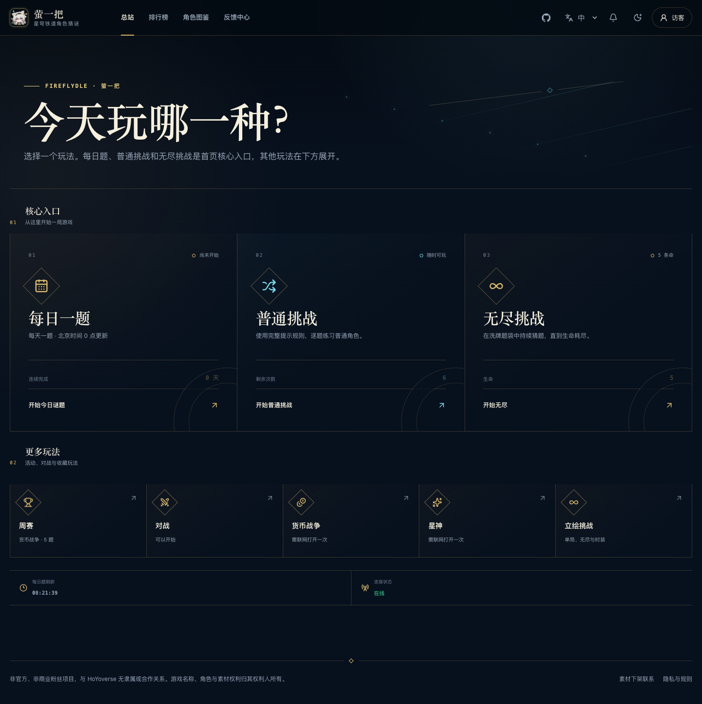
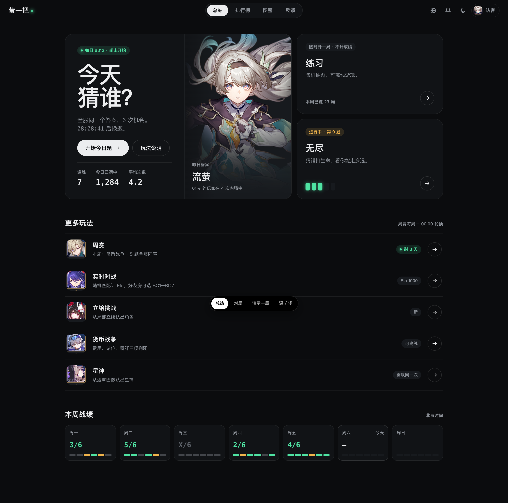
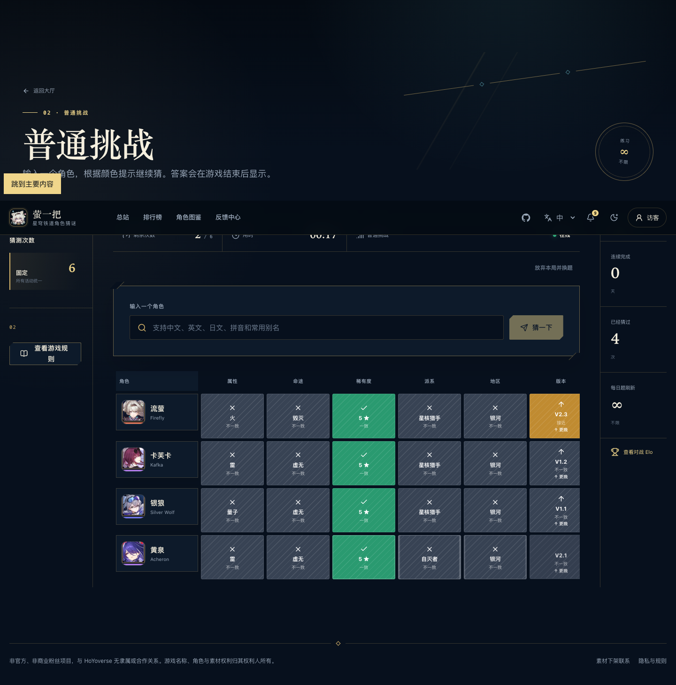
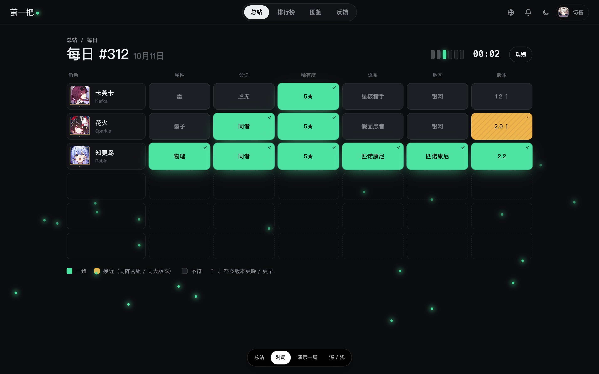
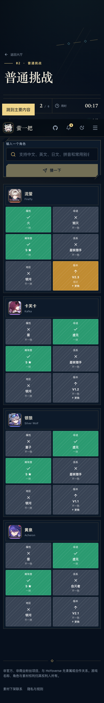
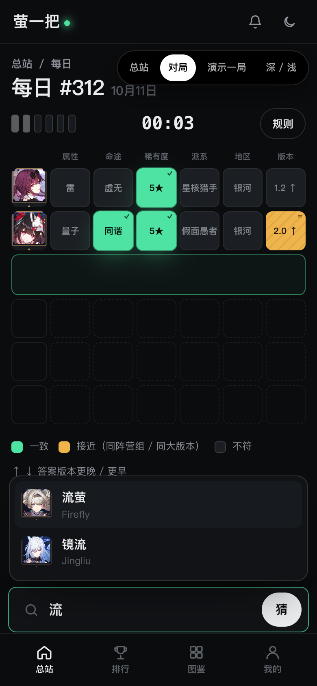

# 萤一把重设计提案 ·「萤光」

> 已被 [v2「星轨」](../redesign-v2/README.md) 取代，保留作对比。

> 状态：提案（未采纳）。可交互原型：[prototype.html](prototype.html)（直接用浏览器打开；底部黑色条可切换 总站 / 对局 / 演示一局 / 深浅主题）。
>
> ⚠️ 与现有决策冲突：`CONTEXT.md` 的「整体动效语言」写的是“沿用现有列车终端、轨道信号、金色与青色……不重做信息架构或品牌风格”。采纳本提案前需要先改这条决策，并同步重写 `docs/DESIGN_SYSTEM.md`。

## 1. 现状诊断：为什么“俗”

| 问题             | 表现                                                                                      | 根因                                               |
| ---------------- | ----------------------------------------------------------------------------------------- | -------------------------------------------------- |
| 配色是模板色     | 深海军蓝 + 香槟金 + 青色，是“高级感游戏官网”最常见的配色                                  | 强调色有 3 个（金 / 青 / 绿），哪一个都不是品牌    |
| 装饰多于信息     | 菱形图标框、卡片角落的同心圆弧、斜线 + 菱形“轨道”、切角票券按钮、`01 / RANKED` 编号小标题 | 每个组件都在“加点东西”，但这些东西没有状态含义     |
| 衬线大标题到处用 | 每个页面都是 80px 宋体式标题（“今天玩哪一种？”“普通挑战”）                                | 编辑排版风格用在游戏上，显得端着，也压低了信息密度 |
| 游戏不在首屏     | 对局页先是约 400px 的页头，棋盘在下面                                                     | 页面按“文章”而不是“游戏”来排版                     |
| 移动端棋盘太长   | 每猜一次占约 400px（2×3 大格），6 猜要滑 2400px                                           | 竖屏没有为棋盘重新设计                             |
| 判题格很吵       | 每个不符格都铺满斜线纹理                                                                  | 用纹理来表达“不符”，但不符恰恰是最该安静的状态     |
| 文案是开发者口吻 | “每日题、普通挑战和无尽挑战是首页核心入口，其他玩法在下方展开”                            | 把信息架构的说明写给了玩家                         |
| 图鉴页 7000px    | 90 张模糊锁定大卡片                                                                       | 未解锁内容用了和已解锁一样的尺寸                   |

另外在 1440 宽的桌面上，右侧信息栏会盖住棋盘的“版本”列（见 `shots/before-game-desktop.png`）。

## 2. 方向

**界面单色，颜色只属于判题。萤光绿 = 猜中 = 品牌。**

- 品牌叫“萤一把”，整站唯一会发光的东西就是“萤火”。Logo 就是字标后面一颗会呼吸的绿点。
- 绿色同时表示“一致”，所以“猜中”这件事和品牌是同一个视觉动作：**把格子点亮**。
- 其余界面全部用中性黑白灰，主按钮直接用反色（深色主题下是白底黑字），不再有金色描边。
- 用角色立绘做主视觉，但不泄题：首页展示 **昨日答案**，结算页展示 **今日答案**。

拒绝：金色描边、菱形框、编号小标题、切角按钮、衬线大标题、常驻粒子。

## 3. 设计令牌

```css
/* dark */
--bg: #0b0c0e;
--bg-2: #111316;
--bg-3: #171a1e;
--line: rgb(255 255 255 / 7%);
--line-2: rgb(255 255 255 / 13%);
--text: #ecedef;
--muted: #8f949b;
--faint: #5d6269;
--lit: #4fe3a3; /* 萤光：品牌 + 一致 */
--near: #f0b44c; /* 接近 */
--miss: #1b1e22; /* 不符：安静 */

/* light：冷白，不用米黄 */
--bg: #f1f2f0;
--bg-2: #fff;
--text: #0e1012;
--lit: #2fcf89;
--near: #f2b13f;
--miss: #e2e4e1;
```

- 字体：只用无衬线粗体。系统字体栈 `HarmonyOS Sans SC, MiSans, PingFang SC, Noto Sans SC`；数字统一用等宽字体并开启 `tabular-nums`。如果要自托管，只给标题用一个子集化的粗字重（先确认字体授权）。
- 圆角：判题格 10px，卡片 22px，所有可点的控件都是胶囊形。这条规则全站一致。
- 不只靠颜色：一致格右上角有 `✓`，接近格有 `≈` 和低对比斜纹，版本列有 `↑ / ↓`。

## 4. 关键界面

### 对局页（最重要）

- 页头压缩成一行：标题 + 次数刻度（6 根竖条）+ 计时 + 规则。
- 棋盘直接用 **6 行固定网格**，未使用的行显示为虚线空槽。剩余次数直接看得出来，不需要再放一个“剩余次数”的数字面板。
- **输入框就是下一行**：桌面端在棋盘里原地输入；移动端输入框固定在底部（拇指够得到），候选列表向上弹出。
- 移动端每一猜 48px 高（头像 + 6 格），6 猜加上输入框能放进一屏。
- 动效：逐格翻开（110ms 错开）→ 一致格亮起一次 → 猜中时整行依次跳起，结算时飘起萤火（只在结算出现，遵循 `prefers-reduced-motion`）。

### 结算

- 左边放答案立绘，右边依次是：结果格（可分享）、**推理复盘漏斗**（每一猜之后还剩多少候选，复用已有的 `InferenceReview` 数据）、连胜 / 胜率 / 超过玩家，以及分享、发起好友挑战、回到总站三个按钮。

### 总站

- 不对称布局：左边“今日”大块（标题、倒计时、开始按钮、连胜 / 今日猜中人数 / 平均次数，右侧配昨日答案立绘），右边上下两块是练习和无尽（无尽直接显示生命和进度）。
- “更多玩法”改成列表行，不再用 5 张同样的卡片。
- “本周战绩”用 7 天的小格展示每天结果，激励连胜。
- 移动端用底部标签栏（总站 / 排行 / 图鉴 / 我的）。

## 5. 落地方式：重写表现层，不重写逻辑

数据流、契约、`useGameSession`、API client、i18n、PWA 都写得很扎实，而且有测试，**不要动**。需要换掉的是约 1 万行全局 CSS（`game.css` 2831 行、`global.css` 1286 行……）和页面 JSX 结构。

1. **基础**：新的 `styles/tokens.css`；新增 `components/ui/`（Button、Chip、Tile、Sheet、Segmented、Stat），用 **CSS Modules**（Vite 原生支持，不加依赖，新旧样式可以共存、不串样式）。
2. **对局**：`GuessBoard` + `CharacterCombobox` + `GamePage` + 结算 + `share-result-image.ts` 换皮（分享图也要换成同一套语言）。
3. **总站** + `ModeShell` + `AppShell`（顶栏胶囊导航 + 移动端底部标签栏）。
4. **其它玩法页**：Endless、Portrait、Aeon、CurrencyWars、Weekly（共用同一个棋盘组件）。
5. **对战**：Duel、Room。
6. **周边页面**：图鉴（改成紧凑头像墙，未解锁的显示剪影）、排行榜、统计、账号。
7. Admin 最后做，或者干脆不改。

每一步单独发 PR，用 Playwright 截图对比 375 / 1440、深色 / 浅色、中 / 英 / 日三种语言（日文和英文的字段名更长，判题格要测换行）。

## 6. 截图

| 现状                               | 提案                              |
| ---------------------------------- | --------------------------------- |
|   |   |
|  |  |
|   |   |
